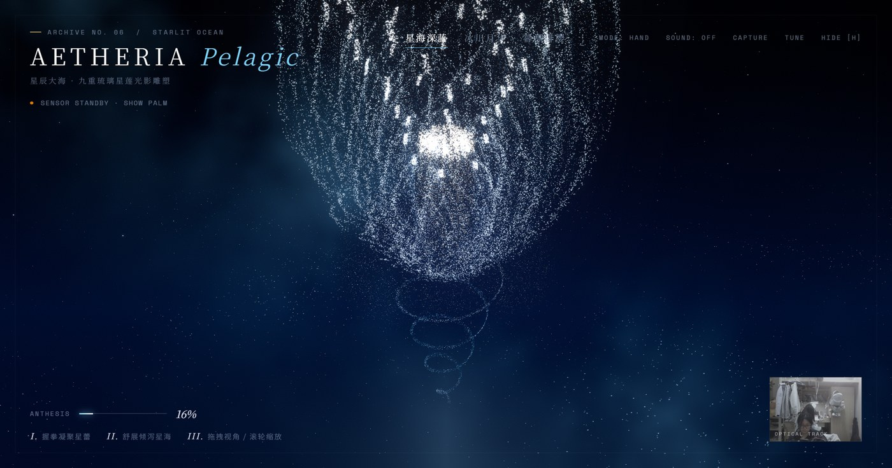

# AETHERIA — No.06 Starlit Ocean Anthesis

> 星辰大海 · 九重琉璃星莲光影雕塑

一个用摄像头手势驱动的粒子光影作品。手掌张开，星莲舒展；握拳，花瓣收拢成星蕾。



## 观看

在线版：**https://ze705.github.io/flower/**

本地运行（需要摄像头权限，浏览器要求 http/https 访问）：

```bash
python -m http.server 8123
```

打开 <http://127.0.0.1:8123/>，允许摄像头。

> 不要直接双击 `index.html` —— `file://` 协议下浏览器禁止访问摄像头。

## 操作

| 动作 | 效果 |
|---|---|
| 张开手掌 | 星莲绽放，粒子倾泻 |
| 握拳 | 收拢为星蕾 |
| 移动手掌 | 雕塑跟随、轻微旋转 |
| 鼠标拖拽 / 滚轮 | 自由视角 / 缩放 |
| `H` | 隐藏界面（纯净模式） |

界面右下角的 **OPTICAL TRACK** 小窗会实时显示手部骨架，确认识别是否正常。

## 技术栈

- **Three.js 0.160** —— 粒子渲染 + ACES 电影级后期
- **MediaPipe Hands** —— 21 个手部关键点，实时手势识别
- **原生 ES Module** —— 无构建步骤
- **UnrealBloomPass** —— 辉光后期

MediaPipe 的模型与 wasm 已本地化到 `vendor/`，不依赖 Google 服务器，国内网络也能秒开。

## 说明

手势张开度由「指尖到腕距离 / 手掌尺寸」归一化得到，并做指数平滑，映射为花瓣绽放程度。

`vendor/` 内为 MediaPipe 官方发布的运行时资源（Apache-2.0）。